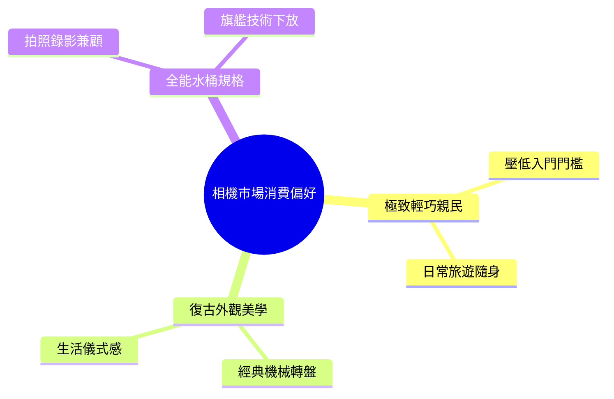

# 2026年1~6月相機銷售排行榜 │你的相機上榜了嗎？【相機王】

> [!abstract] 一句話摘要
> 消費者常在畫質性能、外觀體積與預算間拉扯；實體銷售榜顯示，兼具三萬有找高性價比與隨身輕巧的機種最受大眾青睞，專業旗艦與復古隨身機則呈現極端兩極化需求。

## 01 核心論點

**邏輯總結**：實體通路銷售榜印證，2026 上半年相機市場由「高便攜性」與「親民價格」主導主流銷量，三萬元內的輕巧機種最易轉化為大眾訂單。追求進階畫質的買家則偏好旗艦技術下放、拍照與錄影兼顧的均衡型全幅機，或甘願為復古經典外觀與隨身純拍照體驗長期排隊。

## 02 推導邏輯

1. **統計實體半年銷量** [00:00:15–00:00:33]：打破以往僅統計無反相機的限制，改以全機種實體店面銷售總量進行前十名盤點。
2. **高階水桶機穩居榜尾** [00:00:33–00:01:56]：指出高階定位、全能兼顧但單價較高的新機（如 Z6 III、X-T5）維持在九至十名。
3. **缺貨機受配額限制名次** [00:01:56–00:02:47]：揭示極致隨身機（GR 系列）因全球缺貨與配額不足，實際熱度無法完全反映在銷量名次上。
4. **復古全幅與進階機走穩** [00:02:47–00:07:41]：分析外型、握持手感與下放錄影規格（如 Zf、Z5 II、A7C II）如何承接中高階換機需求。
5. **輕便與親民價格奪冠** [00:07:41–00:08:12]：以三萬有找的定價優勢與極致輕便性下結論，說明大眾消費的最核心痛點仍是日常無負擔攜帶。

## 03 論點展開

### 論點一：全能「水桶機」與高階旗艦提供長期保障，但受單價門檻限制 [[00:33](https://www.youtube.com/watch?v=6MbxuyDe0ac&t=33)]
- **主張**：雙修拍照與高階錄影的均衡型相機能避免頻繁換機，但較高單價使其銷售基數維持在中段班。
- **操作要點**:
  - 拍照加錄影需求一台搞定，首選同級感光元件下放與 4K 120p 規格機種 [[01:03](https://www.youtube.com/watch?v=6MbxuyDe0ac&t=63)]
  - 若追求機身耐用度與防滴防塵，優先挑選鋁鎂合金機身 [[01:52](https://www.youtube.com/watch?v=6MbxuyDe0ac&t=112)]
- **案例一** [00:00:33–00:01:21]: [真實案例] 預算有限但不想買了很快就想換機的買家 → 選擇兼具拍照與 4K 120p 錄影的 Nikon Z6 III → 成為全片幅中 CP 值極高且規格一步到位的水桶機。
  - 原話錨點:「不想買相機很快就要再換機」
- **案例二** [00:01:21–00:01:56]: [真實案例] 富士長勝軍 X-T5 雖上市已久且單價較高 → 憑藉鋁鎂合金機身與拍照錄影平衡表現 → 依然能長年穩定留在前十名。
  - 原話錨點:「幾乎每年都會上」

### 論點二：極致輕便與隨身性具備不可替代性，但飽受產能與配額壓制 [[01:56](https://www.youtube.com/watch?v=6MbxuyDe0ac&t=116)]
- **主張**：純拍照導向的極致口袋相機具備絕對市場渴望，但供應鏈產能不足嚴重扭曲了真實名次。
- **操作要點**:
  - 追求極致高畫質與口袋便攜性，聚焦 APS-C 定焦口袋隨身機 [[02:38](https://www.youtube.com/watch?v=6MbxuyDe0ac&t=158)]
  - 不做動態錄影規劃，僅專注於純靜態生活街拍與隨身紀錄 [[02:30](https://www.youtube.com/watch?v=6MbxuyDe0ac&t=150)]
- **案例** [00:01:56–00:02:47]: [真實案例] 店家客人排隊預定甚至等待超過一年以上 → 店家每期配額極少只能消化一半訂單 → 導致本有實力進前三名的 GR 世代僅卡在第八名。
  - 原話錨點:「等甚至超過一年以上都買不到」

### 論點三：經典外型與握持操縱感的取捨，主導全片幅消費分流 [[02:47](https://www.youtube.com/watch?v=6MbxuyDe0ac&t=167)]
- **主張**：全片幅買家分化為「經典復古外型」與「專業握持效率」兩大派系，鏡頭搭配左右了最終攜帶意願。
- **操作要點**:
  - 選購復古無握把機身時，需預留加裝外接金屬底座握把的預算與重量 [[03:50](https://www.youtube.com/watch?v=6MbxuyDe0ac&t=230)]
  - 復古全幅機身建議搭配輕便餅乾鏡或小定焦（如 40mm F2）以維持配重平衡 [[03:27](https://www.youtube.com/watch?v=6MbxuyDe0ac&t=207)]
  - 重視高效率連續操控與扎實手感，應回歸現代單眼手把配置 [[05:21](https://www.youtube.com/watch?v=6MbxuyDe0ac&t=321)]
- **案例** [00:03:42–00:03:59]: [真實案例] 許多消費者單純為了早期 FM2 的經典機械外型而衝動入手 Nikon Zf → 發現手感單薄難以抓握 → 買了之後紛紛回頭加碼添購副廠或原廠底座握把。
  - 原話錨點:「相當於早期FM2經典外形就衝了」

### 論點四：三萬以內的極致性價比與輕量化是銷量登頂的終極公式 [[07:41](https://www.youtube.com/watch?v=6MbxuyDe0ac&t=461)]
- **主張**：壓在台幣三萬以內的機身定價與無反最輕量體積，是撬動大眾日常紀錄與旅遊市場的最佳甜蜜點。
- **操作要點**:
  - 日常出國旅遊選購，以全機無凸起軍艦部或極度緊湊機身為優先 [[06:30](https://www.youtube.com/watch?v=6MbxuyDe0ac&t=390)]
  - 機身預算控制在 3 萬元以內，搭配輕便 Kit 鏡頭達成出遊無負擔配置 [[07:53](https://www.youtube.com/watch?v=6MbxuyDe0ac&t=473)]
  - 取景習慣依個人偏好挑選：重視陽光下拍照選配 EVF 機型，重視 Vlog 影音選側翻螢幕 [[04:35](https://www.youtube.com/watch?v=6MbxuyDe0ac&t=275)]
- **案例** [00:07:41–00:08:12]: [真實案例] 富士 X-M5 機身定價低於 3 萬台幣、Kit 鏡組僅 3 萬出頭 → 成為榜上除 GR 以外最輕便的無反相機 → 供貨回穩後訂單源源不絕強勢奪下銷售第一名。
  - 原話錨點:「Kit也才3萬出頭」

| 排名 | 機型 | 片幅 | 核心定位與外觀特色 [mm:ss] | 關鍵取捨與適合族群 |
| :--- | :--- | :--- | :--- | :--- |
| **1** | **Fujifilm X-M5** | APS-C | 極致輕量隨身、側翻螢幕、無 EVF [[07:41](https://www.youtube.com/watch?v=6MbxuyDe0ac&t=461)] | 預算有限、Vlog 短影音、出國生活紀錄首選 |
| **2** | **Sony α7C II** | 全片幅 | 緊湊全幅機身、A74 等級拍照錄影規格 [[07:14](https://www.youtube.com/watch?v=6MbxuyDe0ac&t=434)] | 兼顧畫質、全幅感光度與高便攜性之全能用戶 |
| **3** | **Fujifilm X-T50** | APS-C | 凸起軍艦部、內建 IBIS 防手震、具 EVF [[06:48](https://www.youtube.com/watch?v=6MbxuyDe0ac&t=408)] | 追求經典復古機身線條並需要五軸防手震者 |
| **4** | **Fujifilm X-E5** | APS-C | 平頂隨身復古、內建 EVF、上掀翻轉螢幕 [[06:01](https://www.youtube.com/watch?v=6MbxuyDe0ac&t=361)] | 想買 X100VI 溢價缺貨下的最佳可換鏡替換方案 |
| **5** | **Nikon Z5 II** | 全片幅 | 現代單眼人體工學深握把、下放 6K RAW 錄影 [[04:44](https://www.youtube.com/watch?v=6MbxuyDe0ac&t=284)] | 注重快調操控手感、高性價比入門全片幅創作者 |
| **6** | **Fujifilm X-T30 II**| APS-C | 緊湊復古機身、具 EVF、無機身防震 [[04:07](https://www.youtube.com/watch?v=6MbxuyDe0ac&t=247)] | 預算型富士買家、需要觀景窗取景之入門攝影愛好者 |
| **7** | **Nikon Zf** | 全片幅 | FM2 復古軍艦部與轉盤、承襲 Z8 自動對焦 [[02:47](https://www.youtube.com/watch?v=6MbxuyDe0ac&t=167)] | 喜愛機械復古顏值、願意接受配重或加手把的全幅用戶 |
| **8** | **Ricoh GR III 系列**| APS-C | 真正口袋尺寸、定焦純拍照導向、極致便攜 [[01:56](https://www.youtube.com/watch?v=6MbxuyDe0ac&t=116)] | 街拍攝影師、只拍照不錄影、追求極致口袋體積者 |
| **9** | **Fujifilm X-T5** | APS-C | 專業級鋁鎂合金機身、三向翻折螢幕、耐候高防護 [[01:21](https://www.youtube.com/watch?v=6MbxuyDe0ac&t=81)] | 重度靜態攝影、需要耐操機身與高解析度工作機用戶 |
| **10**| **Nikon Z6 III** | 全片幅 | 六邊形全能水桶機、4K 120p、部分堆疊 CMOS [[00:33](https://www.youtube.com/watch?v=6MbxuyDe0ac&t=33)] | 拍照錄影雙修、需要高速對焦與專業錄影規格之進階用戶 |

## 04 取得多元觀點

> [!question] 評議議題
> 2026 年新手或升級相機，是否應優先選擇「3 萬元內極致輕巧入門機」而非「直上全片幅水桶機」？

**顧問團結論**
- **投票**：4 支持、1 反對、1 有條件支持
- **共識**：日常使用「帶得出去拍得到」遠勝於躺在防潮箱的強悍規格，低門檻入門機在頻率與效益上大勝。
- **關鍵前提**：拍攝者的主力用途為日常紀錄、旅遊與自媒體創作，而非高規格商業交付案。
- **分歧線**：財務與執行顧問看重低成本高出勤率；競爭與風險顧問擔憂感光元件片幅落差引發二度換機花費。
- **權重最高**：使用者代言人，相機的真實出勤次數直接決定設備的核心價值。

**各顧問表態**
- 🔧 **執行面顧問** (支持)：重型全幅相機加上大光圈鏡頭出門負擔極大，[影片 00:08:08] 提到的出國旅遊與日常生活，輕巧機身才願意天天帶出門。[模擬觀點] 體積越小、開機拍攝頻率越高，作品產出量自然提升。
- ⚠️ **最壞風險懷疑** (反對)：APS-C 入門機通常缺少五軸防手震或暗部對焦性能稍弱，[影片 00:04:20] 提及部分平價機型夜拍或裁切受限。[模擬觀點] 買家若半年後追求虛化與純淨度，容易落入折價拋售、二次花錢升級全幅的折舊陷阱。
- 🚀 **最大機會願景** (支持)：現今入門機普遍具備旗艦處理器與優異顏色科學，[影片 00:07:53] 三萬出頭即可滿足絕大多數自媒體與生活需求。[模擬觀點] 把省下的五到六萬預算投入鏡頭與旅行體驗，整體成長幅度遠高於純買高階機身。
- ⚔️ **競爭對手** (有條件支持)：手機演算法攝影日益強大，純入門機種若缺乏像富士底片模擬或理光街拍色調的獨特性，極易被旗艦手機取代。[模擬觀點] 只有具備強烈風格特色與手動操控樂趣的輕便相機，才具備對抗手機的護城河。
- 👤 **使用者代言人** (支持)：多數用戶不是專業商業攝影師，[影片 00:01:56] 缺貨一年依然一機難求的現象證明，消費者最渴望的就是隨身、無負擔且隨手能拍出好質感的工具。
- 💰 **財務規劃人員** (支持)：單機身不到三萬、Kit 鏡三萬初的配置，資產占用少且流通性高；相較動輒八萬的進階機身，折舊損失可控，試錯成本極低。

## 05 重要引述
> 「拍照加錄影，一台上機搞定，它是目前尼康裡面 CP 值最高的選擇。」— Jon [[00:45](https://www.youtube.com/watch?v=6MbxuyDe0ac&t=45)]
> 「很多人一定會覺得奇怪，已經這麼難買了，居然只賣到第八名，真的貨太少了！」— Jon [[02:00](https://www.youtube.com/watch?v=6MbxuyDe0ac&t=120)]
> 「相當於早期 FM2 經典外形就衝了，但它的手感還是一個比較大的問題。」— Jon [[03:45](https://www.youtube.com/watch?v=6MbxuyDe0ac&t=225)]
> 「如果只換機身，基本上不用三萬塊台幣，這個榜裡面除了 GR 以外，它是最輕便的無反相機。」— Jon [[07:57](https://www.youtube.com/watch?v=6MbxuyDe0ac&t=477)]

## 06 術語表
| 中文術語 | 英文術語 | 情境定義 |
| :--- | :--- | :--- |
| 水桶機 | All-rounder Camera | 拍照、動態錄影、對焦與連拍無明顯短板的均衡全能相機 [[00:45](https://www.youtube.com/watch?v=6MbxuyDe0ac&t=45)] |
| 電子觀景窗 | EVF (Electronic Viewfinder) | 透過液晶或 OLED 螢幕顯示實時取景畫面的觀景模組 [[04:40](https://www.youtube.com/watch?v=6MbxuyDe0ac&t=280)] |
| 機身防手震 | IBIS (In-Body Image Stabilization) | 透過感光元件微幅位移補償震動的機身五軸防手震技術 [[04:20](https://www.youtube.com/watch?v=6MbxuyDe0ac&t=260)] |
| 鏡頭套裝 | Kit Set | 機身搭配一顆標準變焦或輕便入門鏡頭合售的銷售組合 [[07:53](https://www.youtube.com/watch?v=6MbxuyDe0ac&t=473)] |

## 07 相關筆記
- [[相機選購決策指南]]
- [[街拍口袋機與隨身器材評測]]
- [[富士底片模擬與色彩科學探討]]
- [[全片幅無反錄影與動態規格解析]]

---

## 附錄：上榜相機台灣單價與在台市售日期整理

| 銷售排名 | 相機品牌與型號 | 片幅規格 | 台灣官方建議售價（公司貨） | 台灣通路市售參考價（平輸/實售） | 台灣出廠市售日期 |
| :---: | :--- | :---: | :--- | :--- | :---: |
| **No. 1** | **Fujifilm X-M5** | APS-C | 單機身：NT$ 26,300 XC 15-45mm Kit：NT$ 29,600 | 公司貨現貨約 NT$ 26,300–29,600 | 2024年 12月 04日 |
| **No. 2** | **Sony α7C II (ILCE-7CM2)** | 全片幅 | 單機身：NT$ 59,980 FE 28-60mm Kit：NT$ 68,980 | 公司貨特惠約 NT$ 55,000–58,000 平輸約 NT$ 49,000–52,000 | 2023年 09月 26日 |
| **No. 3** | **Fujifilm X-T50** | APS-C | 單機身：NT$ 45,000 XF 16-50mm Kit：NT$ 58,000 | 單機身約 NT$ 43,000–45,000 | 2024年 06月 26日 |
| **No. 4** | **Fujifilm X-E5** | APS-C | 單機身：約 NT$ 48,100 | 相機王平輸單機約 NT$ 38,000 | 2025年 上半年 |
| **No. 5** | **Nikon Z5 II** | 全片幅 | 單機身：約 NT$ 50,519 | 相機王平輸單機約 NT$ 39,000–40,200 Kit組約 NT$ 52,900 | 2025年 上半年 |
| **No. 6** | **Fujifilm X-T30 II** | APS-C | 單機身：NT$ 25,600 XC 15-45mm Kit：NT$ 29,600 | 通路平輸單機約 NT$ 27,000–28,000 | 2021年 11月 |
| **No. 7** | **Nikon Zf** | 全片幅 | 單機身：NT$ 62,880 40mm F2 Kit：NT$ 69,800 | 公司貨特惠約 NT$ 52,000–56,000 平輸單機約 NT$ 42,300–43,300 | 2023年 10月 12日 |
| **No. 8** | **Ricoh GR III / GR IIIx** | APS-C | **GR III**：NT$ 28,900 (HDF版 NT$ 32,900) **GR IIIx**：NT$ 30,900 (HDF版 NT$ 33,900) | 缺貨溢價約 NT$ 32,000–37,000 | **GR III**：2019年 03月 **GR IIIx**：2021年 10月 **HDF版**：2024年 04月 |
| **No. 9** | **Fujifilm X-T5** | APS-C | 單機身：NT$ 52,990 XF 16-50mm Kit：NT$ 68,200 | 公司貨約 NT$ 51,000–52,990 平輸單機約 NT$ 47,000–49,000 | 2022年 12月 06日 |
| **No. 10**| **Nikon Z6 III** | 全片幅 | 單機身：NT$ 85,880 24-120mm Kit：NT$ 111,880 | 公司貨特惠約 NT$ 78,000–82,000 相機王平輸單機約 NT$ 50,800 | 2024年 07月 01日 |
