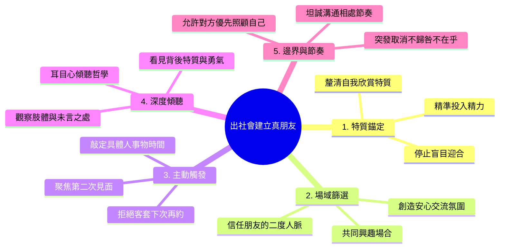
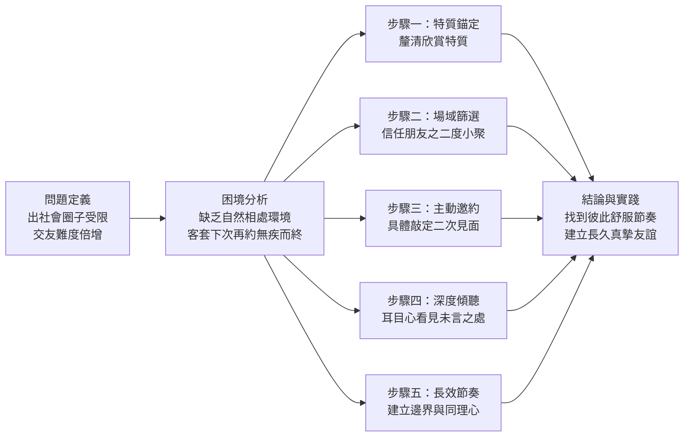
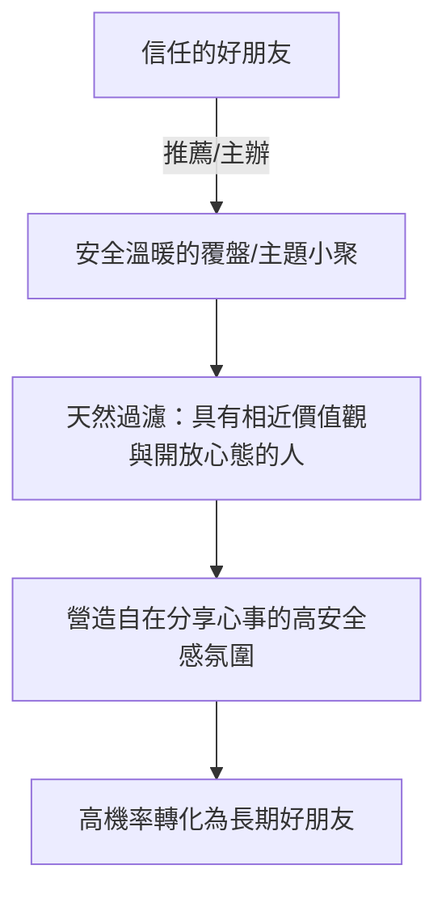
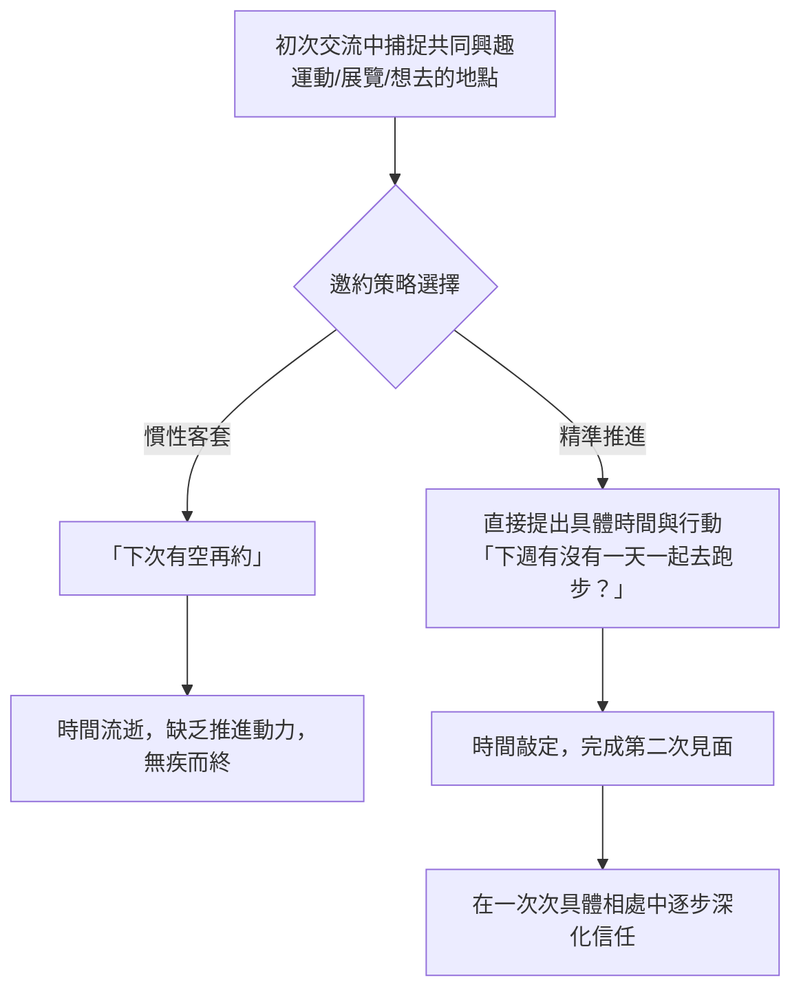

# 出社會後如何找到真正的朋友

> [!summary] 摘要
> * **痛點**：出社會後生活圈多受限於單一職場環境，缺乏學生時期自然變熟的群體場域，導致成年人深陷「社交圈封閉且無效社交疲憊」的孤獨困境。
> * **解法**：從釐清自我欣賞的特質出發，藉由信任朋友的推薦聚會拓展人脈，並以「主動具體邀約」促成二次見面，再透過「耳目心深度傾聽」與「邊界感體諒」深化長遠友誼。
> * **核心觀點**：真正的成年人友誼不必迎合所有人，而是將有限精力投入在同頻者身上，在自在、同理且具備健康邊界的相處節奏中建立高信任連結。

## 01 網頁資訊 (Metadata)

| 屬性 (Property) | 內容 (Value) |
|---|---|
| 來源連結 (Source) | YouTube 影片《出社會後如何找到真正的朋友》 |
| 作者 (Author) | 薑餅資 |
| 發佈日期 (Publish Date) | 2026-10-23 |
| 擷取日期 (Capture Date) | 2026-10-23 |
| 內容類型 (Content Type) | 人際關係與成長思維筆記 |
| 語言 (Language) | 繁體中文 |

## 02 核心論點 (Core Thesis)

### 心智圖 (Mindmap)

### 一段式總結

出社會後的交友本質，是一場從「向外盲目迎合」轉向「向內自我覺察」的精準社交進化；其底層邏輯在於以個人核心價值觀（特質）建立人脈篩選漏斗，藉由信任節點降低互動摩擦力，並透過主動且具體的時間錨定促成二次連結，最終以「看見對方真實模樣」的耳目心傾聽與「尊重個人邊界」的同理心，培育出低耗損、高滋養的長久深層連結。

## 03 敘事脈絡 (Narrative Flow)

### 橫向流程圖 (graph LR)

### 結構解析

* **問題定義**：開篇直指上班族進入單一職場後的典型孤立狀態，點破缺乏自然認識多元朋友管道的現實痛點。
* **困境分析**：剖析成年人交友的兩大阻礙——無效社交帶來的精力耗損，以及停留在口頭「下次再約」所導致的關係自然流失。
* **策略展開（步驟一至五）**：層層遞進地從「自我認知（選人）」→「空間選擇（場合）」→「關係破冰（行動）」→「深度信任（傾聽）」→「長久留存（節奏）」，建構完整的交友閉環。
* **結論與啟發**：回歸人際互動的情感本質，強調唯有具備彈性與邊界感，才能讓高質量的關係無壓力地長遠延續。

## 04 論點展開 (Detailed Arguments)

### 策略一：了解自己欣賞的特質（從自我出發的精力篩選）

出社會後精力有限，不應把時間浪費在討好所有人上面，而要優先釐清自己與何種特質的人相處能獲取能量。

> [!tip] 精力配置原則
> 辨識出能激勵自己的特質（例如：願意持續行動讓生活更好的人），以此作為社交篩選標準，把時間留給值得深入了解的人。

**社交模式對照表**

| 比較維度 | 傳統社交模式 | 特質導向篩選 |
|---|---|---|
| 出發心態 | 廣結善緣、試圖迎合在場所有人 | 錨定自我偏好，鎖定同頻特質 |
| 精力耗費 | 社交電量迅速耗盡，感到內耗疲憊 | 精準投入，相處後感到活力充沛 |
| 篩選依據 | 外在標籤或職銜 | 相處時的心理感受與真實行為表現 |

### 策略二：找到適合的交友環境（高信賴度的二度人脈）

盲目參加陌生大型社交活動往往轉化率極低，應依據目標特質選擇場景，特別是透過「信任朋友推薦或舉辦的小聚」切入。

* **垂直場景切入**：想認識運動夥伴就去路跑或爬山；想認識創作者就參與專門工作坊。
* **二度人脈背書**：信任朋友所吸引的圈子，通常具備相似的溫暖與傾聽特質，能大幅降低陌生社交的防備心理。

### 策略三：主動創造下一次見面（降低二次邀約的摩擦力）

成年人的關係中，「下次再約」幾乎等同於「再也不約」；要讓關係破冰推進，必須在初次互動中迅速錨定具體行動。

> [!note] 二次見面心理學
> 不用在一開始就預設要跟對方成為知己，目標只要單純鎖定在促成「第二次見面」即可，降低彼此的心理負擔。

### 策略四：保持好奇心，試著理解眼前的人（「耳、目、心」傾聽模型）

關係要從點頭之交走向深度信任，不在於你有多會說話，而在於對方是否感受到被真實理解。

**「耳、目、心」傾聽架構**

| 傾聽層次 | 執行方式 | 影片具體案例 |
|---|---|---|
| 耳（Ear） | 專注聆聽語言文字本身，不急著打斷或搶話。 | 聽對方敘述與媽媽吵架的過程。 |
| 目（Eye） | 觀察對方的微表情、眼神與身體緊繃狀態。 | 注意到對方頭低看桌面、雙手反覆搓揉的緊張反應。 |
| 心（Heart） | 同理未言之處，看見行為背後的情緒與特質。 | 給予深刻回饋：「你明明很害怕，卻依然願意面對，真的很勇敢。」 |

### 策略五：找到彼此舒服的節奏（健康的心理邊界與同理心）

長期關係的基石，是允許彼此先照顧好個人的生活狀態，而非用社交義務進行情緒捆綁。

**相處心態對照**

* **不成熟的解讀**：對方臨時改約或取消 → 認為對方不在乎自己、否定這段友誼。
* **成熟健康的解讀**：同理成人各自有生活突發狀況與優先順序，先尊重對方的狀態；若發生頻率過高，則平靜坦誠地表達自己的感受以達成新共識。

## 05 關鍵洞察 & 反思 (Key Insights & Reflections)

### 筆記提煉：4 大高價值啟發

1. **社交不是獵捕，而是「特質共振」**：你不需要提升所有的社交技巧去討好每個人，只要辨識出讓你有能量的特質，你自身的存在就會吸引同頻的夥伴。
2. **克服客套拖延，必須消滅「下次再約」的模糊語句**：社交推進的核心是降低行動摩擦力，把模糊的意願轉化為「特定時間 + 明確活動」的明確提案。
3. **最高級的共情，是「看見未說出口的脆弱與勇氣」**：表面上的稱讚（如「你很棒」）往往廉價，但透過觀察肢體語言並點出對方行動背後的特質，能直接打通深層信任。
4. **健康邊界是長期關係的防腐劑**：允許朋友「把自己放在你之前」，反而能賦予彼此最充份的心理安全感，讓友誼不必在義務與愧疚感中內耗。

> [!important] 核心啟示
> 「以特質為指南針，以二度人脈為入口，以具體邀約為敲門磚，以耳目心為黏著劑，以邊界感為護城河。」這是一套讓出社會後的成年人擺脫孤獨與內耗、構建高質量真實人際網絡的完整實踐法。

## 🏛️ 多元觀點顧問團深度審視 (Panel Review)

> 針對這套交友與關係建立策略，模擬虛擬顧問團的多視角評估：

* 🔧 **執行者（The Operator）**：執行阻力極低。特別是「拋棄下次再約、直接鎖定時間」與「透過朋友的二度人脈篩選」，大幅去除了邀約猶豫與無效試錯，流程具備極高落地性。
* ⚠️ **質疑者（The Skeptic）**：必須注意停損與保護邊界。「耳目心」需要高額情緒勞動與心理資本，若遇到單向索取情緒價值的對象，容易導致社交過載，需在步驟二就嚴格設下停損標準。
* 🚀 **遠見者（The Visionary）**：這是在構建能陪你走 5 到 10 年的人生核心智囊與共創夥伴（如相約完成三鐵或共創專案），這種深層信任連結將成為跨界成長與人生轉折點的強大支撐。
* 👤 **使用者倡導者（The Customer Advocate）**：精準直擊現代職場人「既渴望連結又害怕尷尬尬聊」的集體焦慮，以共同興趣為緩衝墊，讓人在被尊重與被看見中自然卸下防備。
* 💰 **財務思維（The Finance Mind）**：本質是社交資源的資本配置策略——停止在低回報、高損耗的無效人脈上分散投資，將時間重倉押注在高黏著度、高心理淨值的優質關係資產上。

## 06 重要引述 (Key Quotes)

> 「因為很多關係不是沒有機會變熟，而是那句下次再約，但最後真的就沒有下一次了。」—— 薑餅資

> 「那也不用一開始就想著要跟對方變成很好的朋友，你只要先創造第二次見面的機會就好。」—— 薑餅資

> 「如果妳仔細觀察，『聽』這個字裡面其實包含了耳朵、眼睛跟心……有時候眼睛看到的跟用心感受到的，是耳朵聽不到的東西。」—— 薑餅資

> 「他希望朋友在做選擇的時候可以先考慮自己的狀態跟感受，再來考慮他的；同樣的，當他臨時有事需要調整安排的時候，也希望朋友願意理解，不要立刻把它解讀成不在乎。」—— 薑餅資

## 07 術語表 (Glossary)

| 術語 (中文) | 英文對照 | 觀念定義 |
|---|---|---|
| 特質錨定 | Trait Anchoring | 透過自我覺察釐清相處舒適的特質，作為社交精力分配的篩選標準。 |
| 二度人脈小聚 | Second-degree Connection Meetup | 由信任的朋友所引薦或主辦的小型社群活動，具備天然的信任過濾機制。 |
| 二次見面邀約 | Second-meeting Trigger | 藉由具體活動與時間邀約，降低成年人社交摩擦力，避免關係在口頭客套中流失。 |
| 耳目心傾聽法 | Tri-Sensory Active Listening | 結合耳朵（聽話語）、眼睛（觀肢體微表情）與心靈（體會情緒與動機）的三層次深度傾聽技術。 |
| 關係心理邊界 | Psychological Boundaries in Friendship | 允許彼此在友誼中保有個人生活優先權，避免將合理調整行程誤讀為關係冷漠。 |

## 08 相關筆記 (Related Notes)

* [[成年人的精力管理：如何停止無效社交與情感內耗]]
* [[主動傾聽與非語言溝通：耳目心模型的實踐指南]]
* [[強連結與弱連結：從信任節點建立個人智囊圈]]
* [[關係邊界感修煉：在親密與獨立之間找到舒適平衡]]
* [[AI 時代核心心法總結：真實人性連結的不可替代性]]
