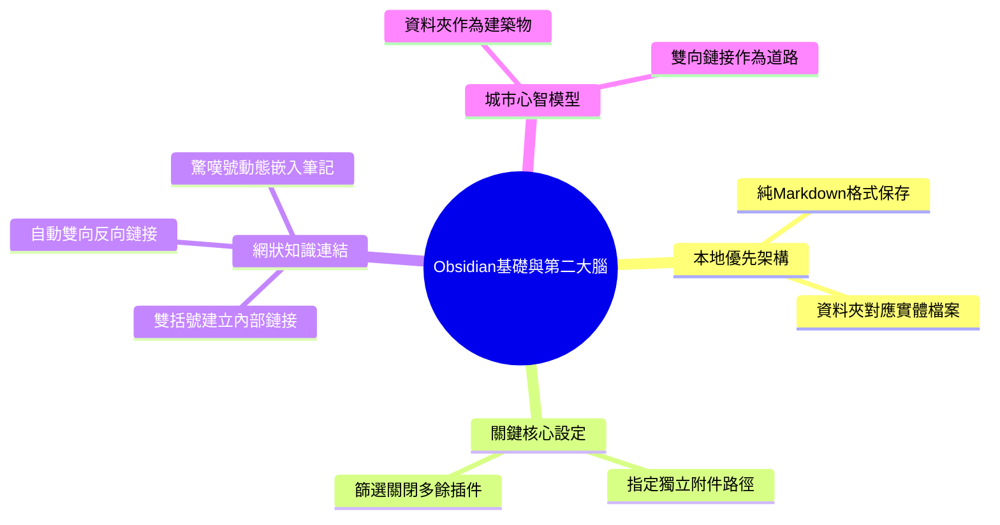

# 零基礎20分鐘學會Obsidian 95%功能！

> [!abstract] 一句話摘要
> 多數人誤將收藏吃灰當成知識管理；解法是透過 Obsidian 本地優先架構與 Markdown 雙向鏈接，以「資料夾為建築、鏈接為道路」的心智模型打造不被軟體綁架的第二大腦。

## 01 核心論點

**邏輯總結**:
Obsidian 以本地純文字檔案保障使用者的資料所有權，避免陷入傳統筆記工具的知識囤積困境。透過雙向鏈接與佔位筆記機制，使用者能在不中斷思考的前提下自發建立主題網絡，並藉由關係圖譜與城市心智模型，釐清實體分類與概念流動的邊界。

## 02 推導邏輯

1. **傳統筆記淪為知識囤積** [[00:13](https://www.youtube.com/watch?v=NIhT5pd4Znc&t=13)]: 指出使用者收藏大量內容卻吃灰且難以重複利用的痛點。
2. **改採本地優先Markdown** [[02:28](https://www.youtube.com/watch?v=NIhT5pd4Znc&t=148)]: 提出以電腦本地資料夾儲存純文字檔，保障數據掌控權與通用性。
3. **規範附件避免庫面混亂** [[08:13](https://www.youtube.com/watch?v=NIhT5pd4Znc&t=493)]: 給出指定附件資料夾與精簡插件的操作建議，維持工作區秩序。
4. **用雙括號串聯筆記概念** [[12:26](https://www.youtube.com/watch?v=NIhT5pd4Znc&t=746)]: 推翻傳統單向歸檔思維，透過雙括號即時連結或預建尚未存在的筆記。
5. **以關係圖譜湧現知識網絡** [[15:33](https://www.youtube.com/watch?v=NIhT5pd4Znc&t=933)]: 展示筆記隨時間自然聚合成主題聚類，形成動態思維地圖。
6. **確立城市與道路分類模型** [[16:34](https://www.youtube.com/watch?v=NIhT5pd4Znc&t=994)]: 下結論，以建築物與道路的比喻嚴格劃分資料夾與鏈接的使用時機。

## 03 論點展開

### 論點一: 本地優先與通用格式保障數據自主權 [[02:28](https://www.youtube.com/watch?v=NIhT5pd4Znc&t=148)]
- **主張**: 筆記應以純 Markdown 形式存放於本機端，確保不被特定軟體鎖定且兼顧人機可讀性。
- **操作要點**:
  - 手動建立新倉庫（Vault），明確指定本機端硬碟的存放目錄。
  - 將 Obsidian 視為對映本機資料夾的介面，本機與軟體內的檔案變更即時雙向同步。
- **案例** [04:12–04:47]: [真實案例] 講者建立名為「李廠長第二大腦」的倉庫，並在軟體中新建「YouTube」資料夾與「YouTube 數據」筆記 → 電腦實體硬碟資料夾同步產生完全對應的資料夾與 .md 檔案。
  - 原話錨點:「新建一個文件家叫 YouTube 你的文件家裡呢就會同步出現它」

> [!tip] 關鍵操作
> 建立倉庫時建議選擇手動建立而非快速開始，才能完全自訂知識庫的名稱與硬碟實體路徑。

### 論點二: 附件集中分流與插件精簡維護 [[08:13](https://www.youtube.com/watch?v=NIhT5pd4Znc&t=493)]
- **主張**: 透過強制指定附件目錄與審慎管理插件，防止知識庫根目錄因拖曳檔案而失序膨脹。
- **操作要點**:
  - 至「檔案與鏈接」設定中，將附件預設存放路徑改為指定資料夾（如「附件」）。
  - 檢視官方核心插件，主動關閉不需要的工具（如錄音功能）。
  - 關閉第三方安全模式以瀏覽社群插件，優先依下載量排序篩選熱門穩定擴充套件。
- **案例** [08:42–09:10]: [真實案例] 講者在軟體中新建「附件」資料夾並指定為儲存路徑，隨後直接拖曳圖片至編輯區 → 圖片自動存入該附件目錄，維持根目錄乾淨且未生成多餘筆記。
  - 原話錨點:「直接拖一張圖片到筆記裡 Obsidian呢就會自動把那個圖片存到附件文件」

### 論點三: 雙向鏈接與佔位引用串聯思考心流 [[12:26](https://www.youtube.com/watch?v=NIhT5pd4Znc&t=746)]
- **主張**: 使用雙括號建立內部鏈接與反向鏈接，可在不切斷寫作思緒的情況下建立概念網狀結構。
- **操作要點**:
  - 輸入 `[[` 叫出既有筆記選單進行快速關聯。
  - 輸入尚未建立的筆記名稱先行標記，事後再點擊生成筆記內容。
  - 利用反向鏈接面板檢視引用來源；輸入 `![[筆記名稱]]` 直接動態嵌入全文。
- **案例** [13:09–13:30]: [真實案例] 講者在編輯時以雙括號輸入未建立的筆記「obsidian深度用法」 → 該鏈接呈現淡色標記，點擊後系統才正式生成筆記，實現不中斷思考的延伸記錄。
  - 原話錨點:「輸入一個還不存在的筆記鏈接叫 obsidian 深度用法」

### 論點四: 「城市與道路」心智模型劃分組織邊界 [[16:31](https://www.youtube.com/watch?v=NIhT5pd4Znc&t=991)]
- **主張**: 資料夾僅用於存放具備固定實體屬性的資源，筆記間的概念交流應全數交給鏈接與圖譜。
- **操作要點**:
  - 資料夾作為「建築物」：嚴格限用於存放附件、模板、日曆、每日日記或歸檔項目。
  - 雙向鏈接作為「道路」：只要兩個概念存在關聯即建立鏈接，讓主題在關係圖譜中自然聚集成圈。
- **案例** [16:34–17:03]: [比喻] 講者把知識庫比喻為一座城市，將資料夾比喻為固定位置的建築物，而鏈接比喻為連接建築物的道路 → 說明資料夾不負責內容交流，概念間的碰撞完全依賴道路般的鏈接。
  - 原話錨點:「把你的 Obsidian 知識庫想像成是一座城市」

| 組織維度 | 實體比喻 | 適用對象 | 核心機制 |
| --- | --- | --- | --- |
| **資料夾 (Folder)** | 建築物 | 附件、模板、歸檔專案、每日筆記 | 決定知識資源在本機檔案系統中的實體存放位置 |
| **雙向鏈接 (Link)** | 道路 | 跨領域概念、靈感關聯、主題筆記 | 展現不同節點的流動關係，於關係圖譜形成主題圈 |

## 04 取得多元觀點

> [!question] 評議議題
> 是否應採納「以 Obsidian 為核心的本地優先與雙向鏈接」作為個人第二大腦管理體系？

**顧問團結論**
- **投票**: 3 支持、0 反對、2 有條件支持
- **共識**: 顧問團一致肯定本地 Markdown 的資料所有權與防鎖定優勢，但強調必須克制插件膨脹與無意義鏈接，避免落入工具維護的次級陷阱。
- **關鍵前提**: 使用者需具備持續寫作並建立關聯的習慣，否則雙向鏈接圖譜將淪為無意義的空節點。
- **分歧線**: 願景者重視長期語意網絡湧現與 AI 整合潛力；懷疑者則聚焦於建構雙向鏈接所消耗的認知成本與初期混亂風險。
- **權重最高**: 🔧 執行者。軟體再強大，關鍵仍在於能否無痛落地於日常工作流，而非陷入配置調校。

**各顧問表態**
- 🔧 **執行者** (有條件支持): [影片] 演示了手動配置附件資料夾 [[08:31](https://www.youtube.com/watch?v=NIhT5pd4Znc&t=511)] 能有效避免目錄雜亂，這在執行層面是必做的防呆機制。[模擬觀點] 但若新手在初期花過多時間折騰社群插件或微調排版，會嚴重稀釋產出；建議前一個月維持核心插件運作，驗證鏈接習慣成立後再擴充。
- ⚠️ **懷疑者** (有條件支持): [影片] 指出傳統筆記容易在收藏夾吃灰 [[00:18](https://www.youtube.com/watch?v=NIhT5pd4Znc&t=18)]，然而雙向鏈接若未經消化，同樣會演變成「圖譜式吃灰」。[模擬觀點] 佔位筆記功能雖方便，但極易產生大量未完成的幽靈節點，若缺乏定期的整理回顧機制，關係圖譜終將變成混亂的蜘蛛網。
- 🚀 **願景者** (支持): [影片] 明確提到純 Markdown 檔案是人類與 AI 溝通的良好橋樑且未來不會過時 [[05:02](https://www.youtube.com/watch?v=NIhT5pd4Znc&t=302)]。[模擬觀點] 這種本地語意網絡在累積數百篇筆記後，能與本地大型語言模型完美對接，解鎖跨學科脈絡的自動合成能力，長線複合效益極高。
- 👤 **使用者代言人** (支持): [影片] 提出的「城市與道路」比喻 [[16:34](https://www.youtube.com/watch?v=NIhT5pd4Znc&t=994)] 成功化解了初學者在資料夾層級上的分類焦慮。[模擬觀點] 雙括號鏈接讓人在記錄當下不必中斷思路去決定分類目錄，大幅降低了寫作時的認知摩擦力。
- 💰 **財務腦** (支持): [影片] 強調本套方法全功能免費 [[01:06](https://www.youtube.com/watch?v=NIhT5pd4Znc&t=66)]，相較於昂貴的雲端 SaaS 訂閱制筆記軟體，直接省下持續性開銷。[模擬觀點] 雖然前期需投入約 2 小時熟悉 Markdown 標記語法與路徑邏輯，但消除了日後供應商終止服務或漲價的沉沒成本，投資報酬率顯著。

## 05 重要引述
> 「很多時候呢，我們做的並不是知識管理，而是知識囤積。」— 李廠長 [[00:13](https://www.youtube.com/watch?v=NIhT5pd4Znc&t=13)]
> 「你的筆記屬於你自己，他們呢不會被鎖在 Obsidian 這個應用裡，我們呢始終對自己的數據擁有完全的控制權。」— 李廠長 [[05:15](https://www.youtube.com/watch?v=NIhT5pd4Znc&t=315)]
> 「文件夾呢就像是裡面的建築物...而鏈接或者反向鏈接呢就像是道路，道路呢是不會移動建築物本身的，而是展示了不同地點之間的連接關係。」— 李廠長 [[16:38](https://www.youtube.com/watch?v=NIhT5pd4Znc&t=998)]
> 「在記筆記的時候有了新的想法呢就可以先寫下來，之後呢再進行補充，不需要中斷思路去新建一個筆記。」— 李廠長 [[13:31](https://www.youtube.com/watch?v=NIhT5pd4Znc&t=811)]

## 06 術語表
| 中文術語 | 英文術語 | 情境定義 |
| --- | --- | --- |
| 倉庫 / 知識庫 | Vault | Obsidian 在電腦本機端存放所有筆記、附件與設定設定檔的實體根目錄資料夾。 |
| 反向鏈接 | Backlinks | 系統自動雙向追蹤機制，能於側邊欄顯示目前筆記被哪些其他筆記引用的清單。 |
| 快速切換 | Quick Switcher | 透過鍵盤快捷鍵快速搜尋筆記名稱並在檔案間跳轉的導航工具。 |
| 關係圖譜 | Graph View | 將筆記節點與彼此之間的鏈接關係可視化呈現的網狀思維地圖。 |
| 白板 | Canvas | 可在無限畫布上自由拖曳卡片、文字、筆記與圖片，並連線理清思路的視覺工具。 |

## 07 相關筆記
- [[卡片盒筆記法與雙向鏈接實踐]]
- [[Markdown語法與本地優先資料管理]]
